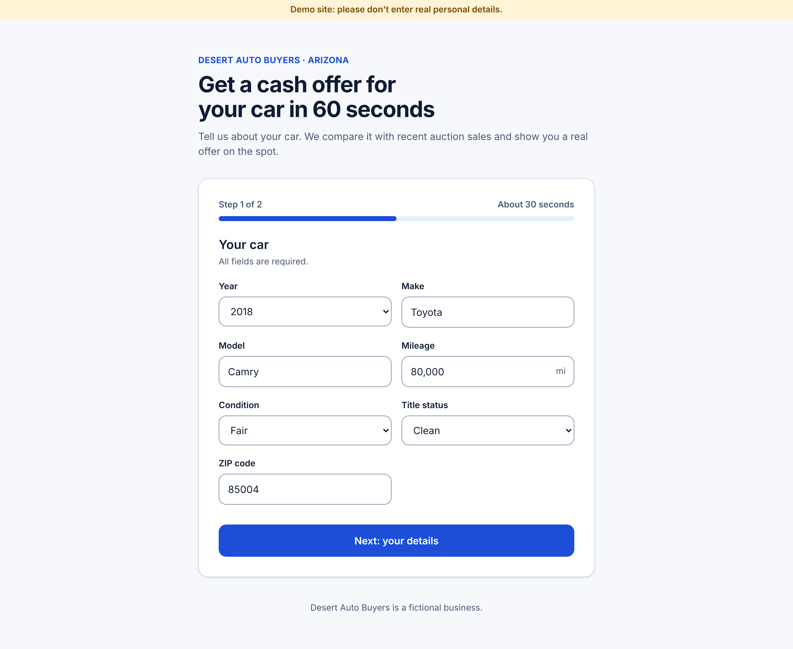
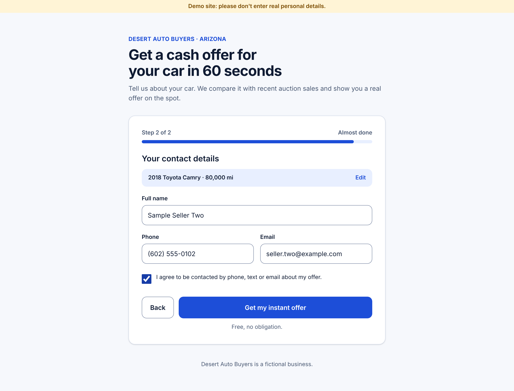
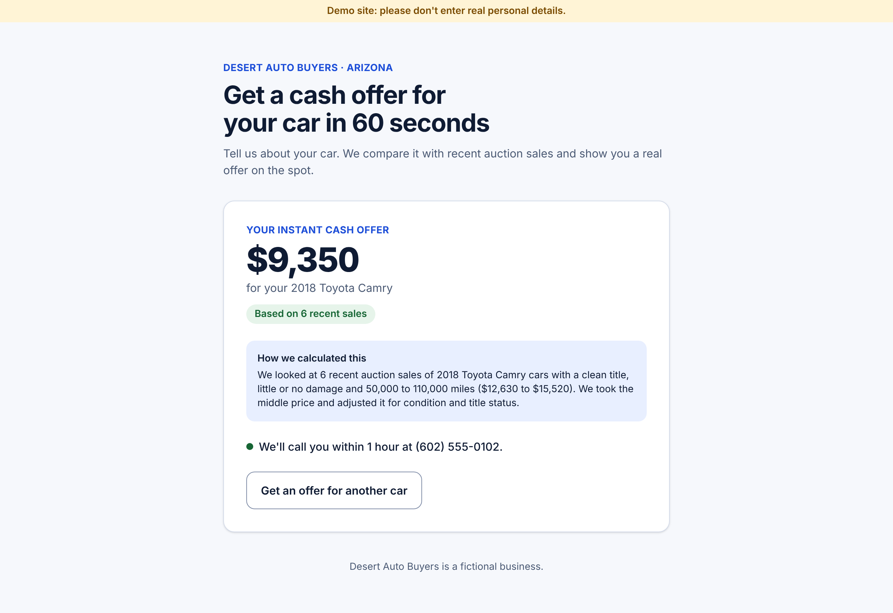
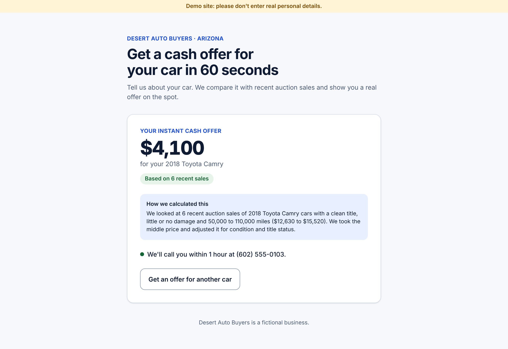
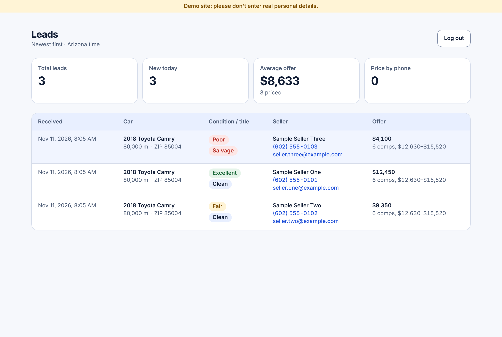
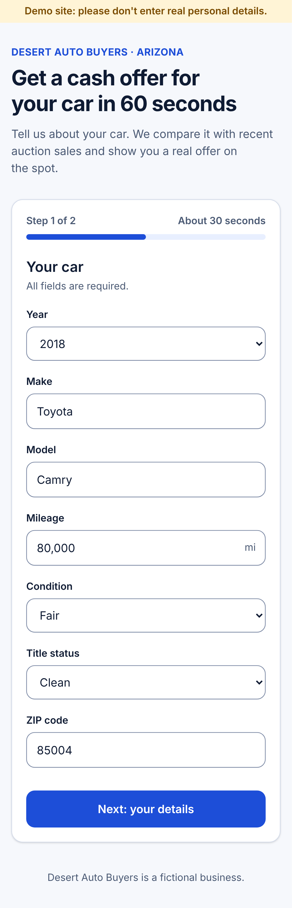
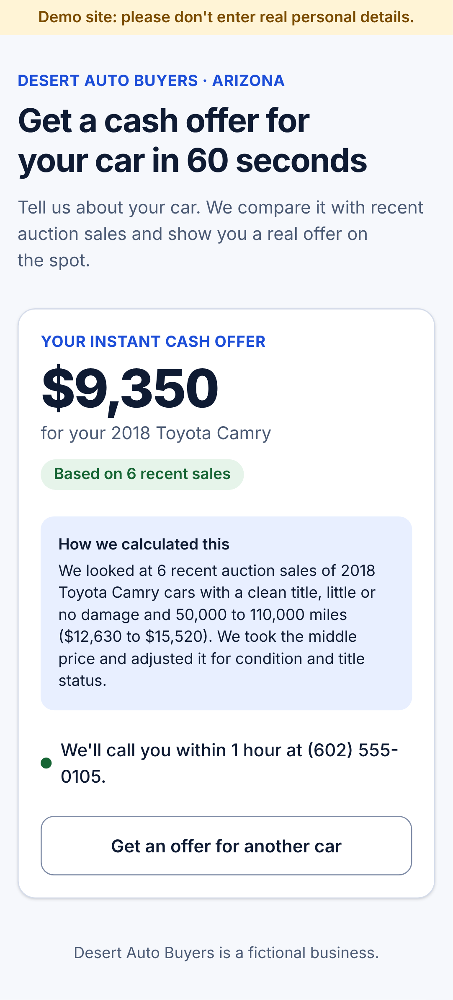
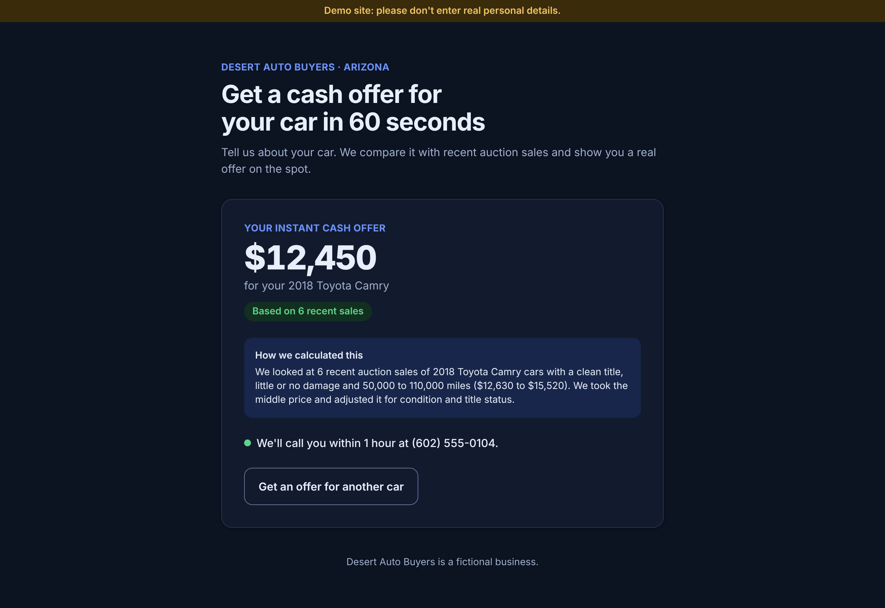

# Instant Cash Offer: Desert Auto Buyers (demo)

A one-page site where a seller enters their car and contact details and gets an instant cash offer. Every lead is saved and listed on a password-protected `/admin` page.

Desert Auto Buyers is a fictional business. This is a demo.

## Screenshots

All data in these images is fake. The comparable sales are mock data until a real auction API key is connected.

| Step 1: the car | Step 2: contact details |
|---|---|
|  |  |

**The offer, with a short explanation of how it was calculated**



**Same car, Poor condition and Salvage title: a lower offer, calculated by the same rules**



**Admin page** (password-protected): leads newest first, with the offer and the number of comparable sales used.



**Mobile and dark mode**

| Mobile form | Mobile result | Dark mode |
|---|---|---|
|  |  |  |

## How the offer is calculated

All rules are in one place: `OFFER_RULES` in [`src/lib/offer.ts`](src/lib/offer.ts).

1. Find recent auction sales of the same year, make and model (`src/lib/auctions.ts`; mock data for now). Only sales with a **clean title** and **light or no damage** count, because Copart and IAAI sell many damaged cars.
2. Mileage: first use sales within ±30,000 miles of the seller's car. If there are fewer than 3, try ±60,000 miles. There is no "any mileage" step, so a very unusual car (for example 400,000 miles) is priced by a person, not given a wrong instant offer.
3. Take the median (middle) price.
4. Multiply by the condition factor: Excellent 1.0, Good 0.9, Fair 0.75, Poor 0.55.
5. Multiply by 0.6 if the title is Salvage or Rebuilt.
6. Take off a 15% margin and round down to the nearest $50.

Example: median $12,810, Good, Clean → 12,810 × 0.9 × 0.85 = $9,799 → **$9,750**.

If fewer than 3 similar sales are found, the lead is still saved and the seller is told we'll call with an offer.

## Run it locally

Needs Node.js 20 or newer.

```bash
npm install
cp .env.local.example .env.local   # then fill in ADMIN_PASSWORD (12+ characters)
npm run dev                        # http://localhost:3000
npm test                           # offer math + admin session tests
```

Locally, without `DATABASE_URL`, leads are saved to `data/leads.json`.

## Settings (environment variables)

| Name | Needed | What it is |
|---|---|---|
| `ADMIN_PASSWORD` | Yes | Password for `/admin`. At least 12 characters, or login stays disabled. |
| `DATABASE_URL` | On Vercel | Neon Postgres connection string. The `leads` table is created automatically on first use. |
| `AUCTIONS_API_KEY` | Later | AuctionsAPI key. Empty = mock comparable sales. |

## Deploy (Vercel + Neon)

1. Import the GitHub repo in Vercel.
2. Add a free Neon database (Vercel > Storage, or neon.tech) and set `DATABASE_URL`.
3. Set `ADMIN_PASSWORD` (a strong one, different from local).
4. Deploy, submit one test car, check `/admin`.

## Security

- All form fields are checked on the server, not only in the browser.
- Public form: hidden bot-trap field, limit of 10 offers per 10 minutes per IP, contact consent required.
- `/admin`: password from env, constant-time compare, signed session cookie (httpOnly, SameSite=Strict, 8 hours), 15-minute lockout after 5 wrong passwords, login events in the server log.
- Security headers (CSP, HSTS, X-Frame-Options and others) in `next.config.ts`.
- Rate limits are kept in server memory. Before real traffic, move them to Upstash Ratelimit or Vercel Firewall rules.

## Going live (for a real business)

- **Comparable data:** AuctionsAPI is not an official Copart/IAAI API. Before going live, ask them for the monthly price, the request limit, and whether showing derived prices on a public website is allowed.
- **Auction prices:** Copart and IAAI are mostly insurance/salvage auctions, so even clean-title prices there are below retail. Check the offers against real data with the business and tune the factors and margin in `OFFER_RULES`.
- **Damage filter:** which damage types count as "light" (`LIGHT_DAMAGE` in `src/lib/auctions.ts`) must be checked against a real API response.
- **Phone/SMS contact:** check the consent wording with the business's legal adviser (TCPA).
